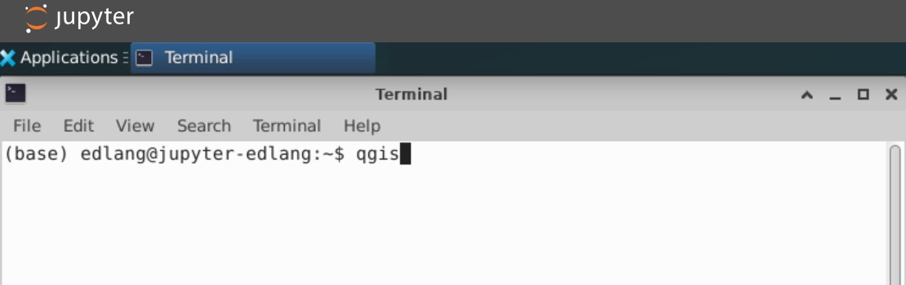
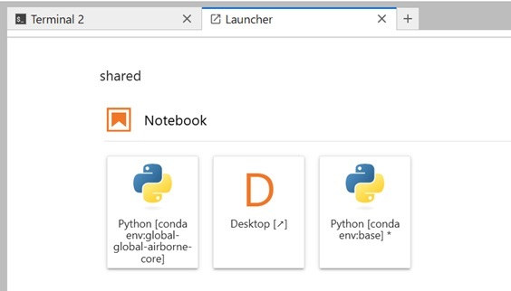

======================
Using QGIS on the SMCE
======================

QGIS is available on the SMCE through a virtual desktop environment. This allows you to use QGIS with full access to your JupyterHub files and the shared storage system.

**Best for:** Visualization, map creation, and interactive exploration of geospatial data. For heavy geoprocessing or analysis, consider using Python-based tools in JupyterLab instead.

Starting the QGIS Environment
==============================

Step 1: Launch the QGIS Image
------------------------------

1. When selecting a server, choose the **JupyterLab-QGIS** image
2. Select your desired instance type (see :doc:`compute_resources` for guidance)
3. Start the server

Step 2: Open the Virtual Desktop
---------------------------------

Once your server starts, you'll see the JupyterLab interface with a launcher.

1. In the launcher, click the **Desktop** icon to open the virtual desktop in a new tab

2. A new browser tab will open with a Linux desktop environment

Step 3: Launch QGIS
--------------------

1. In the virtual desktop, open a **terminal** (usually available in the taskbar or applications menu)
2. Type ``qgis`` and press Enter

3. QGIS will open and is ready to use

Working with Data in QGIS
==========================

File Access
-----------

QGIS has access to all the same files as your JupyterHub environment:

* **Home directory:** ``/home/jovyan``
* **Shared local storage:** ``/shared/users-local/<username>``
* **S3-backed storage:** ``/shared/users-bucket/<username>``

You can open and save files directly to these locations just like you would in JupyterLab.

Loading Data from S3
---------------------

The SMCE's FSx for Lustre filesystem allows you to access S3 data directly in QGIS without downloading files first.

To use S3-backed data:

1. Navigate to ``/shared/users-bucket/<username>`` or project-specific bucket mounts
2. Load raster or vector data as you normally would in QGIS
3. Data is automatically cached for fast access (see :doc:`storage` for more details)

This is particularly useful for large geospatial datasets like satellite imagery or LiDAR data.

Saving Your Work
================

**Save project files and outputs to appropriate storage:**

* **QGIS project files (.qgz):** Save to your home directory or ``/shared/users-local`` for quick access
* **Large outputs (rasters, processed data):** Save to ``/shared/users-bucket`` for unlimited storage
* **Temporary files:** Can go in home directory but clean up when done (only 30GB available)

See :doc:`storage` for best practices on where to store different types of files.

Troubleshooting
===============

Virtual Desktop Goes to Sleep
------------------------------

The virtual desktop may go to sleep after a period of inactivity.

**To resume:**

1. Return to your JupyterLab tab
2. Click the **Desktop** icon in the launcher again
3. The desktop should resume where you left off
4. If QGIS was open, it should still be running